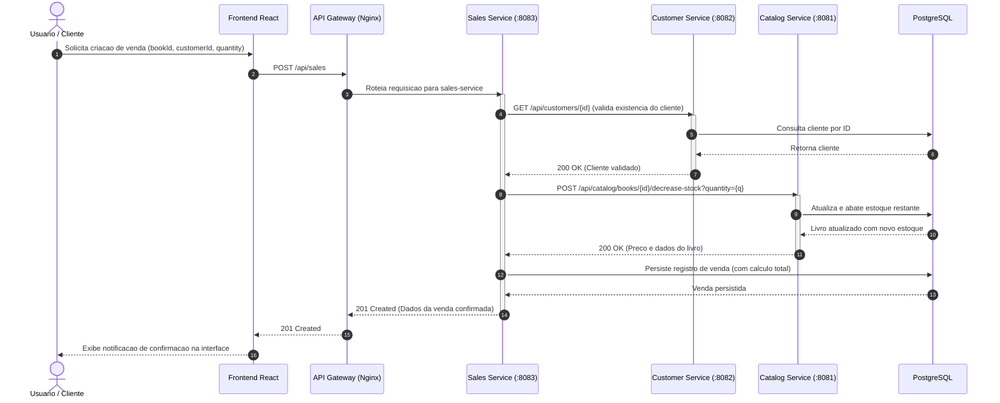

# BookStore — Sistema de Gerenciamento de Livraria

Sistema distribuído baseado em microsserviços para gerenciamento acadêmico de livraria contendo:
- **Microsserviços Java 21 + Spring Boot 3.4**: Catálogo, Clientes e Vendas estruturados em arquitetura em camadas (`controller`, `service`, `repository`, `model`, `dto`, `mapper` com MapStruct);
- **Leitura Automática de Ambiente**: Integração com `spring-dotenv` para carregamento automático do arquivo `.env` da raiz;
- **API GraphQL** integrada nativamente ao serviço de catálogo (`/graphql`);
- **API Gateway Nginx** para roteamento e proxy reverso unificado;
- **PostgreSQL 16** para persistência relacional;
- **Frontends SPA**: React (Vite) e Vue.js (Vite) com proxy reverso dinâmico;
- **Integrações Externas**: Google Books API, ViaCEP, QR Server e Nager.Date;
- **Análise de Carga**: Scripts de benchmark com k6.

---

## Arquitetura do Sistema

```mermaid
flowchart TD
    subgraph Clients ["Camada de Apresentacao / Frontends"]
        ReactApp["Frontend React (Vite)<br/>:5173 local / :5175 docker"]
        VueApp["Frontend Vue (Vite)<br/>:5174"]
    end

    subgraph EntryPoint ["Gateway e Proxy Reverso"]
        Gateway["Nginx API Gateway / Vercel Proxy<br/>:8080"]
    end

    subgraph Services ["Microsservicos Backend (Spring Boot 3.4 / Java 21)"]
        Catalog["Catalog Service<br/>:8081<br/>REST & GraphQL (/graphql)"]
        Customer["Customer Service<br/>:8082<br/>Gestao de Clientes"]
        Sales["Sales Service<br/>:8083<br/>Orquestracao de Vendas"]
        Security["security-common<br/>Modulo compartilhado de seguranca"]
    end

    subgraph DB ["Camada de Persistencia"]
        Postgres[("PostgreSQL 16 / Neon<br/>:5432 (bookstore)")]
    end

    subgraph ExternalAPIs ["Integracoes e APIs Externas"]
        GoogleBooks["Google Books API"]
        ViaCEP["ViaCEP"]
        QRServer["QR Server API"]
        NagerDate["Nager.Date"]
    end

    %% Requisicoes de clientes
    ReactApp -->|Requisicoes /api/* e /graphql| Gateway
    VueApp -->|Requisicoes /api/*| Gateway
    VueApp -.->|Consulta Feriados| NagerDate

    %% Roteamento do Gateway
    Gateway -->|/api/catalog/* e /graphql| Catalog
    Gateway -->|/api/customers/*| Customer
    Gateway -->|/api/sales/*| Sales

    %% Orquestracao interna de Vendas
    Sales -->|1. Valida Cliente (GET /api/customers/:id)| Customer
    Sales -->|2. Abate Estoque (POST /api/catalog/books/:id/decrease-stock)| Catalog

    %% Dependencia compartilhada
    Catalog -.->|Utiliza| Security
    Customer -.->|Utiliza| Security
    Sales -.->|Utiliza| Security

    %% Integracoes externas
    Catalog -.->|Busca Obras| GoogleBooks
    Catalog -.->|Gera QR Code| QRServer
    Customer -.->|Busca Endereco por CEP| ViaCEP

    %% Persistencia
    Catalog -->|JPA / Hibernate| Postgres
    Customer -->|JPA / Hibernate| Postgres
    Sales -->|JPA / Hibernate| Postgres
```

---

## Fluxo de Orquestração de Vendas

Diagrama de sequência exibindo a comunicação síncrona entre os microsserviços durante o registro de um pedido:



---

## Estrutura do Repositório

```text
BookStore/
├── backend/                  # Microsserviços Java e pom.xml pai
│   ├── catalog-service/      # Gestão de livros, estoque e GraphQL (porta 8081)
│   ├── customer-service/     # Gestão de clientes e consulta ViaCEP (porta 8082)
│   ├── sales-service/        # Orquestração e registro de vendas (porta 8083)
│   ├── security-common/      # Módulo compartilhado de filtros JWT e segurança
│   ├── Dockerfile.service    # Build multi-stage para imagens Docker
│   └── pom.xml               # Parent POM (Java 21, Spring Boot 3.4, MapStruct, spring-dotenv)
├── frontend/                 # Interfaces de usuário
│   ├── frontend-react/       # Aplicação React + Vite (porta 5173 local / 5175 docker / Vercel)
│   └── frontend-vue/         # Aplicação Vue.js + Vite (porta 5174)
├── gateway/                  # Configuração do Nginx reverse proxy
│   └── nginx.conf
├── performance/              # Testes de carga com k6
│   ├── bookstore-load-test.js
│   └── README.md
├── start-backend.sh          # Script de inicialização dos 3 microsserviços backend
├── start-frontend.sh         # Script de inicialização dos frontends (React e Vue)
├── stop-local.sh             # Script para interrupção de todos os serviços locais
├── docker-compose.yml        # Orquestração de todos os serviços em contêineres
├── .env.example              # Modelo padrão de variáveis de ambiente
└── README.md                 # Documentação e instruções de execução
```

---

## Configuração de Variáveis de Ambiente (.env)

Antes de iniciar o projeto, copie o modelo `.env.example` para `.env` na raiz do repositório:

```bash
cp .env.example .env
```

### Detalhamento das Variáveis

| Variável | Padrão | Descrição |
| :--- | :--- | :--- |
| `POSTGRES_DB` | `bookstore` | Nome do banco de dados no PostgreSQL |
| `POSTGRES_USER` | `bookstore` | Usuário de autenticação do PostgreSQL |
| `POSTGRES_PASSWORD` | `bookstore` | Senha de autenticação do PostgreSQL |
| `POSTGRES_HOST` | `localhost` (local) / `db` (docker) | Host de conexão com o banco |
| `POSTGRES_PORT` | `5432` | Porta do PostgreSQL (ajuste caso use porta alternativa, como 5433) |
| `SPRING_DATASOURCE_URL` | `jdbc:postgresql://localhost:5432/bookstore` | URL JDBC consumida pelos microsserviços Spring |
| `SPRING_DATASOURCE_USERNAME` | `bookstore` | Usuário informado ao Spring Datasource |
| `SPRING_DATASOURCE_PASSWORD` | `bookstore` | Senha informada ao Spring Datasource |
| `CATALOG_SERVICE_PORT` | `8081` | Porta HTTP do microsserviço de catálogo |
| `CUSTOMER_SERVICE_PORT` | `8082` | Porta HTTP do microsserviço de clientes |
| `SALES_SERVICE_PORT` | `8083` | Porta HTTP do microsserviço de vendas |
| `CATALOG_URL` | `http://localhost:8081` | URL interna que o serviço de vendas usa para falar com catálogo |
| `CUSTOMER_URL` | `http://localhost:8082` | URL interna que o serviço de vendas usa para falar com clientes |
| `GATEWAY_PORT` | `8080` | Porta externa exposta pelo Nginx Gateway |
| `GATEWAY_URL` | `http://localhost:8080` | URL do gateway para roteamento dos frontends |
| `REACT_PORT` | `5173` | Porta local do frontend React |
| `VUE_PORT` | `5174` | Porta local do frontend Vue |

> [!NOTE]
> Os microsserviços utilizam a biblioteca `spring-dotenv`. Ao iniciar via Maven ou IDE, o arquivo `.env` localizado na raiz do repositório é lido de forma 100% automática, sem necessidade de exportar as variáveis previamente no terminal.

---

## Opção 1: Executar com Docker Compose (Modo Contêiner)

Executa toda a stack (PostgreSQL, 3 microsserviços Java, Nginx Gateway e os 2 frontends SPA) de forma isolada e pré-configurada.

### Pré-requisitos
- **Docker Engine** (versão 24+) e **Docker Compose** (versão v2+);
- Certifique-se de que o daemon do Docker está ativo:
  ```bash
  docker info
  ```
- Portas liberadas na máquina: `5432`, `8080`, `8081`, `8082`, `8083`, `5174` e `5175`.

---

### Passo a Passo de Execução

1. **Subir todos os contêineres e compilar imagens**:
   ```bash
   docker compose up --build
   ```
   > Para executar em segundo plano (detached mode), adicione a flag `-d`:
   > ```bash
   > docker compose up -d --build
   > ```

2. **Verificar o status dos contêineres em execução**:
   ```bash
   docker compose ps
   ```
   Todos os serviços (`db`, `catalog-service`, `customer-service`, `sales-service`, `gateway`, `frontend-react` e `frontend-vue`) devem exibir o status `Up` ou `running`.

3. **Acompanhar os logs de um serviço específico**:
   ```bash
   # Logs do servico de catalogo
   docker compose logs -f catalog-service

   # Logs do gateway nginx
   docker compose logs -f gateway

   # Logs de todos os servicos juntos
   docker compose logs -f
   ```

---

### URLs de Acesso no Modo Docker

| Recurso | URL |
| :--- | :--- |
| **Frontend React** | http://localhost:5175 |
| **Frontend Vue** | http://localhost:5174 |
| **API Gateway Nginx** | http://localhost:8080 |
| **Catálogo de Livros (REST)** | http://localhost:8080/api/catalog/books |
| **Clientes (REST)** | http://localhost:8080/api/customers |
| **Vendas (REST)** | http://localhost:8080/api/sales |
| **GraphQL Endpoint** | http://localhost:8080/graphql |
| **Health Check do Catálogo** | http://localhost:8080/actuator/health |

---

### Parar os Serviços no Docker

Para encerrar a execução dos contêineres:
```bash
docker compose down
```

Para encerrar e **remover todos os dados persistidos** no volume do banco:
```bash
docker compose down -v
```

---

## Opção 2: Executar Localmente (Sem Docker)

Execute cada componente diretamente no seu sistema operacional para depuração rápida ou desenvolvimento ativo.

### Pré-requisitos de Ambiente Local
- **Java JDK 21** instalado:
  ```bash
  java -version
  ```
- **Apache Maven 3.9+** instalado:
  ```bash
  mvn -version
  ```
- **Node.js 20+** e **npm** instalados:
  ```bash
  node -v
  npm -v
  ```
- **PostgreSQL 16** instalado e em execução:
  ```bash
  # No Linux
  systemctl status postgresql
  ```

---

### Passo 1: Preparar o Banco de Dados PostgreSQL Local

1. Conecte-se ao seu PostgreSQL via cliente `psql`:
   ```bash
   psql -U postgres
   ```
2. Crie a base de dados e o usuário com permissões completas:
   ```sql
   CREATE DATABASE bookstore;
   CREATE USER bookstore WITH ENCRYPTED PASSWORD 'bookstore';
   GRANT ALL PRIVILEGES ON DATABASE bookstore TO bookstore;
   ALTER DATABASE bookstore OWNER TO bookstore;
   ```
   > Caso seu PostgreSQL já utilize outro banco, porta (ex: `5433`), usuário ou senha, configure os valores correspondentes no seu arquivo `.env` (`SPRING_DATASOURCE_URL`, `SPRING_DATASOURCE_USERNAME`, `SPRING_DATASOURCE_PASSWORD`).

---

### Método A: Inicialização Rápida via Scripts Automatizados (.sh) — Recomendado

Para simplificar o desenvolvimento diário e evitar abrir múltiplos terminais manuais, utilize os scripts executáveis na raiz do repositório:

#### 1. Iniciar os 3 Microsserviços Backend (Terminal 1)
```bash
./start-backend.sh
```
* **Validações Pré-Execução**: Confere a existência do `.env`, conexão com o PostgreSQL e a disponibilidade das portas (`8081`, `8082`, `8083`);
* **Ordem de Inicialização**: Inicia `catalog-service` e `customer-service` em paralelo e, após estarem prontos, sobe o `sales-service`;
* **Logs Isolados**: Cada serviço gera log em `logs/catalog-service.log`, `logs/customer-service.log` e `logs/sales-service.log` (acompanhe com `tail -f logs/*.log`);
* **Health Check**: Monitora o endpoint `/actuator/health` de cada microsserviço até responder `UP`;
* **Encerramento Limpo**: Ao pressionar `Ctrl + C`, finaliza todos os processos Java em background e libera as portas;
* *Execução individual (opcional):* `./start-backend.sh catalog`, `./start-backend.sh customer` ou `./start-backend.sh sales`.

#### 2. Iniciar os Frontends React e Vue (Terminal 2)
```bash
./start-frontend.sh
```
* **Instalação Automática**: Instala as dependências (`npm install`) caso a pasta `node_modules` não esteja presente;
* **Inicialização Conjunta**: Inicia o frontend React (porta `5173`) e o frontend Vue (porta `5174`) simultaneamente;
* **Logs Isolados**: Saídas direcionadas para `logs/frontend-react.log` e `logs/frontend-vue.log` (acompanhe com `tail -f logs/frontend-*.log`);
* **Encerramento Limpo**: Ao pressionar `Ctrl + C`, finaliza todos os servidores Vite em execução;
* *Execução individual (opcional):* `./start-frontend.sh react` ou `./start-frontend.sh vue`.

#### 3. Interromper Todos os Serviços Locais
Caso algum terminal tenha sido fechado de forma abrupta e as portas permaneçam ocupadas:
```bash
./stop-local.sh
```

---

### Método B: Inicialização Manual Passo a Passo (Terminais Individuais)

Graças ao plugin `spring-dotenv` configurado no `pom.xml`, o Spring Boot lê automaticamente seu `.env` ao inicializar.

Recomenda-se iniciar os microsserviços na ordem abaixo (Catálogo e Clientes primeiro, pois Vendas depende de ambos):

#### Terminal 1 — Iniciar o Catálogo (`catalog-service` - porta 8081)
```bash
cd backend
mvn spring-boot:run -pl catalog-service
```
Ou executando da raiz do repositório:
```bash
mvn spring-boot:run -f backend/pom.xml -pl catalog-service
```
*Verifique o status em:* http://localhost:8081/actuator/health

#### Terminal 2 — Iniciar os Clientes (`customer-service` - porta 8082)
```bash
cd backend
mvn spring-boot:run -pl customer-service
```
Ou executando da raiz do repositório:
```bash
mvn spring-boot:run -f backend/pom.xml -pl customer-service
```
*Verifique o status em:* http://localhost:8082/actuator/health

#### Terminal 3 — Iniciar as Vendas (`sales-service` - porta 8083)
```bash
cd backend
mvn spring-boot:run -pl sales-service
```
Ou executando da raiz do repositório:
```bash
mvn spring-boot:run -f backend/pom.xml -pl sales-service
```
*Verifique o status em:* http://localhost:8083/actuator/health

---

### Execução Alternativa via Arquivos JAR Empacotados

Se preferir compilar e rodar os binários `.jar`:

```bash
# Compila todos os modulos sem rodar testes
cd backend
mvn clean package -DskipTests

# Em terminais separados:
java -jar catalog-service/target/catalog-service-1.0.0.jar
java -jar customer-service/target/customer-service-1.0.0.jar
java -jar sales-service/target/sales-service-1.0.0.jar
```

---

### Passo 3: Executar os Frontends (React e Vue)

Os arquivos de configuração do Vite (`vite.config.js`) possuem detecção dinâmica de ambiente:
- Quando executado **sem Docker**, o Vite redireciona requisições de API diretamente para os microsserviços locais (`http://localhost:8081`, `http://localhost:8082`, `http://localhost:8083`).
- Não é necessário ter o gateway Nginx rodando para testar os frontends localmente.

#### Terminal 4 — Frontend React (porta 5173)
```bash
cd frontend/frontend-react
npm install
npm run dev
```
Acesse a aplicação React no navegador: **http://localhost:5173**

#### Terminal 5 — Frontend Vue (porta 5174)
```bash
cd frontend/frontend-vue
npm install
npm run dev
```
Acesse a aplicação Vue no navegador: **http://localhost:5174**

---

## Guia de Testes e Validação das APIs

Substitua `localhost:8080` (Gateway/Docker) pela porta direta do microsserviço caso esteja rodando localmente sem Docker (`8081` para catálogo, `8082` para clientes, `8083` para vendas).

### 1. Cadastrar um Livro (Catálogo REST)
```bash
curl -X POST http://localhost:8080/api/catalog/books \
  -H "Content-Type: application/json" \
  -d '{
    "title": "Clean Code",
    "authors": "Robert C. Martin",
    "price": 89.90,
    "stock": 10
  }'
```
*Resposta esperada (HTTP 201 Created):*
```json
{"id":1,"title":"Clean Code","authors":"Robert C. Martin","price":89.90,"stock":10}
```

### 2. Consultar Livros Cadastrados
```bash
curl -X GET http://localhost:8080/api/catalog/books
```

### 3. Cadastrar um Cliente (Com validação de CEP via ViaCEP)
```bash
curl -X POST http://localhost:8080/api/customers \
  -H "Content-Type: application/json" \
  -d '{
    "name": "Maria Silva",
    "email": "maria.silva@example.com",
    "cep": "01001-000"
  }'
```
*Resposta esperada (HTTP 201 Created):*
```json
{
  "id": 1,
  "name": "Maria Silva",
  "email": "maria.silva@example.com",
  "cep": "01001-000",
  "street": "Praça da Sé",
  "neighborhood": "Sé",
  "city": "São Paulo",
  "state": "SP"
}
```

### 4. Registrar uma Venda (Orquestração de Microsserviços)
O serviço de vendas verifica o cliente no `customer-service`, abate o estoque no `catalog-service` e persiste o pedido:
```bash
curl -X POST http://localhost:8080/api/sales \
  -H "Content-Type: application/json" \
  -d '{
    "customerId": 1,
    "bookId": 1,
    "quantity": 2
  }'
```

### 5. Consultar Livros via GraphQL
Envie requisição POST para `/graphql`:

**Listagem com campos específicos:**
```bash
curl -X POST http://localhost:8080/graphql \
  -H "Content-Type: application/json" \
  -d '{"query":"{ books { id title price stock } }"}'
```

**Criação de livro via GraphQL Mutation:**
```bash
curl -X POST http://localhost:8080/graphql \
  -H "Content-Type: application/json" \
  -d '{"query":"mutation { createBook(title: \"Domain-Driven Design\", authors: \"Eric Evans\", price: 135.0, stock: 5) { id title stock } }"}'
```

### 6. Integrações Externas

- **Google Books API** (pesquisa de obras externas):
  ```bash
  curl "http://localhost:8080/api/integrations/google-books?q=spring+boot"
  ```
- **ViaCEP** (consulta direta de logradouro por CEP):
  ```bash
  curl "http://localhost:8080/api/customers/cep/01001000"
  ```
- **QR Server** (geração de QR Code com dados do livro):
  ```bash
  curl -I "http://localhost:8080/api/catalog/books/1/qr"
  ```

---

## Solução de Problemas Comuns (Troubleshooting)

### Erro: `Connection to localhost:5432 refused` ou falha de autenticação
- **Causa**: O serviço do PostgreSQL não está rodando ou suas credenciais locais diferem do padrão.
- **Solução**:
  1. Verifique se o PostgreSQL está ativo: `systemctl status postgresql` (Linux) ou `brew services list` (macOS).
  2. Caso seu PostgreSQL esteja em outra porta (ex: `5433`), ajuste no arquivo `.env`:
     ```env
     SPRING_DATASOURCE_URL=jdbc:postgresql://localhost:5433/bookstore
     SPRING_DATASOURCE_USERNAME=seu_usuario
     SPRING_DATASOURCE_PASSWORD=sua_senha
     ```

### Erro: `Web server failed to start. Port 8081 was already in use`
- **Causa**: Um processo anterior do microsserviço ainda está ativo no sistema.
- **Solução**:
  1. Identifique o PID ocupando a porta:
     ```bash
     lsof -i :8081
     ```
  2. Finalize o processo:
     ```bash
     fuser -k 8081/tcp
     # ou
     kill -9 <PID>
     ```

### Erro de dependências no Maven
- **Solução**: Limpe o cache local e compile o projeto raiz:
  ```bash
  cd backend
  mvn clean install -DskipTests
  ```

### Erro de CORS ao rodar os frontends sem Docker
- **Solução**: Certifique-se de que está acessando o frontend através das portas do Vite (`http://localhost:5173` ou `http://localhost:5174`), que realizam o proxy automático das requisições para os microsserviços.

---

## Análise de Carga e Benchmark (k6)

Consulte o guia completo em [`performance/README.md`](performance/README.md).

Para rodar os testes de carga:
```bash
# Apontando para o Gateway (Docker)
k6 run performance/bookstore-load-test.js

# Apontando para os microsserviços em outra porta/host
k6 run -e BASE_URL=http://localhost:8080 performance/bookstore-load-test.js
```

---

## Hospedagem em Produção (Vercel, Render e Neon)

O sistema está preparado para deploy desacoplado em nuvem:

- **Frontend (Vercel)**: SPA React hospedada na Vercel com roteamento e proxy reverso configurados via `frontend/frontend-react/vercel.json` (eliminando problemas de CORS no navegador);
- **Backend (Render)**: Microsserviços `catalog-service`, `customer-service` e `sales-service` executados como Web Services Docker utilizando o `backend/Dockerfile.service`;
- **Banco de Dados (Neon)**: PostgreSQL serverless com SSL ativo (`sslmode=require`), com criação automática de tabelas via Hibernate `ddl-auto: update`.
